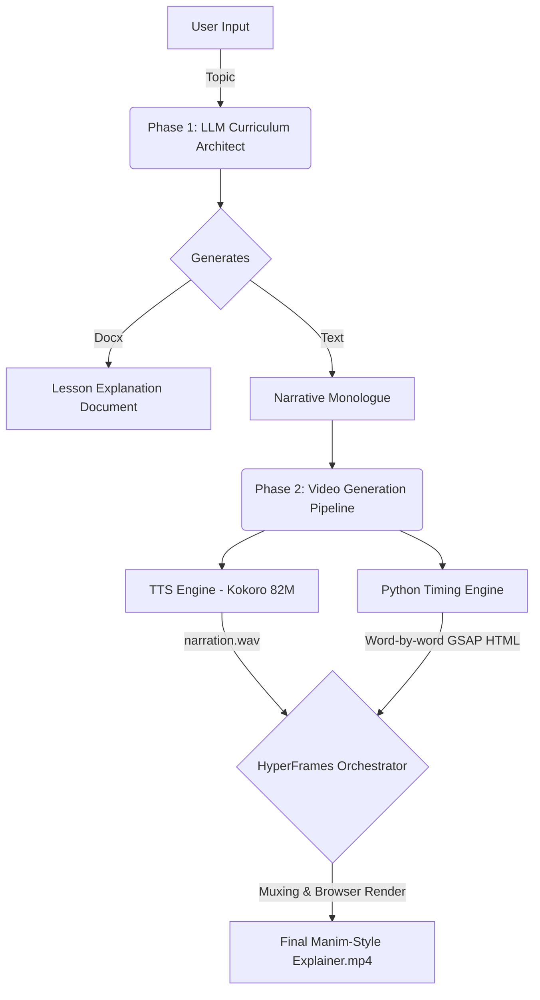

# 🎓 AI Curriculum Architect & Explainer Engine ( The Explainer )

The **AI Curriculum Architect** is an automated, two-phase educational pipeline built with Python, Streamlit, and HyperFrames. It allows a user to input an abstract topic, automatically generate a comprehensive educational curriculum (with a narrative monologue), and perfectly orchestrate that monologue into a synchronized, 15-second Manim-style kinetic typography video.

## 🌟 Features

*   **Phase 1: Curriculum Generation**
    *   Interactive chat interface to narrow down educational focus.
    *   Generates a full educational lesson plan (exportable to `.docx`).
    *   Generates a focused "Narrative Monologue" script meant to be read aloud.
*   **Phase 2: Cinematic Video Synthesis**
    *   **Local TTS Engine:** Synthesizes the monologue into a high-quality voiceover using the `Kokoro-82M` local AI voice model.
    *   **Algorithmic Timing:** A custom Python engine mathematically breaks down the monologue into grammatical phrases and calculates proportional millisecond timings for every single word based on the length of the TTS audio track.
    *   **HyperFrames Orchestration:** Uses GSAP within a headless browser to generate a flawless, synchronized kinetic typography video (Manim-style). Words sequentially reveal themselves precisely as they are spoken, and phrases cleanly wipe away.

## 🏗️ System Architecture Schema



## 🚀 Local Development Setup

To run this project locally, you need Python, Node.js (for Hyperframes), and FFmpeg.

### 1. System Requirements
*   Python 3.10+
*   Node.js 22+
*   FFmpeg (Required for video muxing)
    ```bash
    # Ubuntu/Debian
    sudo apt-get update && sudo apt-get install -y ffmpeg
    ```

### 2. Python Dependencies
Clone the repository and install the required Python packages:
```bash
pip install -r requirements.txt
pip install kokoro-onnx soundfile
```

### 3. Run the App
Launch the Streamlit dashboard:
```bash
streamlit run app.py
```
